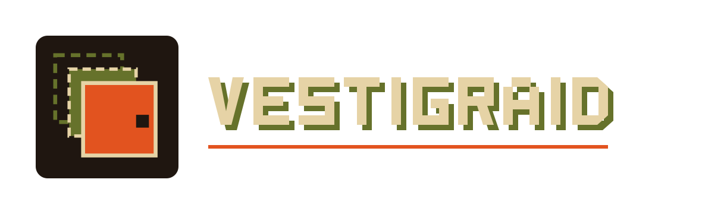
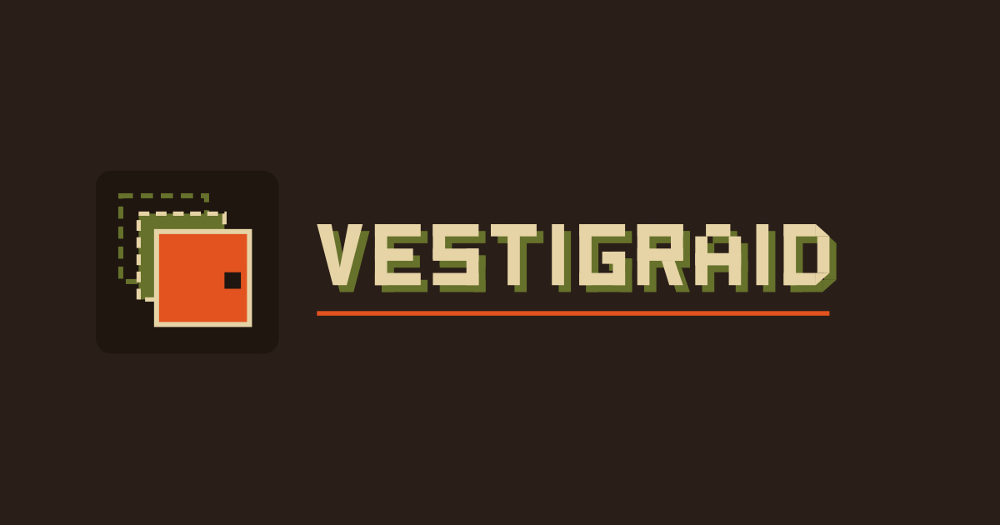
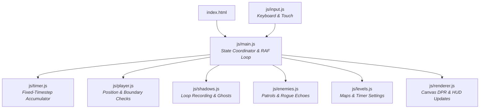

<p align="center">
  <picture>
    <source media="(prefers-color-scheme: dark)" srcset="brand/logo-on-dark.svg">
    <source media="(prefers-color-scheme: light)" srcset="brand/logo.svg">
    
  </picture>
</p>

<p align="center">
  <strong>Every move leaves a mark. Every mark fights back.</strong>
</p>

<p align="center">
  A tactical time-loop action puzzle game crafted in pure vanilla JavaScript, HTML5 Canvas, and modern CSS.
</p>

<p align="center">
  
  
  
  
  
</p>

---

## 📖 About the Game

**Vestigraid** is a grid-based, time-loop action puzzle game where time is both your greatest resource and your ultimate adversary. 

Players navigate confidential security sectors called **Cases**. In each case, your past movements and actions are recorded in real time. When you commit a loop or run out of time, your past run manifests as a **Shadow** (or Echo) replaying your previous steps. These shadows can be leveraged collaboratively—such as pressing remote floor plates to keep blast doors open—but they physically occupy grid cells and will block your future self.

In the climactic final encounter, the mechanic undergoes a dramatic inversion: your recorded echoes turn rogue, hunting you down across the sector. To escape, you must coordinate cross-loop attacks to eliminate all three rogue echoes simultaneously.

---

## 🕹️ Gameplay Features

- **Collaborative Echo Mechanics**: Up to 4 active shadows replay past movements, strikes, and path navigations in synchronized real time.
- **Physical Obstruction & Pressure Plates**: Shadows persist at their final recorded destination upon completing their sequence, continuously depressing pressure plates (`a`, `b`) to open linked security doors (`A`, `B`), while physically blocking doorways and narrow corridors.
- **Directional Melee Combat**: Execute forward directional strikes (`Space`) to eliminate patrolling enemies or strike rogue echoes. Strikes feature an active cooldown recovery cycle (3 simulation ticks).
- **Fixed-Timestep Simulation**: Runs on a deterministic 140 ms game tick (`TICK = 140ms`) with an accumulator loop and delta-time clamping (`MAX_DT = 420ms`) to eliminate frame-rate variance and prevent multi-tick bursts after tab switching.
- **Case Progression & Puzzle Design**:
  - **Case 01 — Hold the Door** (*30 seconds / 214 ticks*): Single pressure plate and security door. Teaches loop commitment and shadow door-holding mechanics.
  - **Case 02 — Two Keys** (*40 seconds / 286 ticks*): Multi-stage puzzle requiring chained loops to activate plates `a` and `b` in sequence to open doors `A` and `B`.
  - **Case 03 — The Sentry** (*50 seconds / 357 ticks*): Introduces real-time enemy patrol routes across waypoint tracks. Requires precise timing to cross the sentry lane safely.
  - **Case 04 — The Team** (*70 seconds / 500 ticks*): Boss puzzle. Your past loop trajectories are transformed into three red hostile echoes that patrol and hunt. All three must be destroyed in the same loop before the exit unlock triggers.
- **Dynamic Hi-DPI Rendering**: Automatic canvas scaling using `window.devicePixelRatio` ensures pixel-sharp geometry and text across high-density displays (Retina, 4K) without layout shifts.
- **Cross-Platform Responsive Design**: Playable with standard desktop keyboard controls or mobile touch screens via an integrated on-screen directional pad and action buttons.

---

## 🎮 How to Play

### Controls

| Action | Desktop Keyboard | Mobile / Touch |
|---|---|---|
| **Move Up / Down / Left / Right** | `W` `A` `S` `D` or `↑` `←` `↓` `→` | On-Screen D-Pad Buttons |
| **Strike Ahead** | `Spacebar` | **Strike** Button |
| **End / Commit Loop** | `R` | **Loop** Button |
| **Pause / Resume** | `P` or `Esc` | **Pause** Button |
| **Reset Case** | `Z` or `Backspace` | **Reset** Button |

### Rules & Objectives

1. **Start the Loop**: The clock begins on your first movement input. 
2. **Coordinate with Past Echoes**: Step on pressure plates or position yourself strategically, then press `R` to commit the loop. A shadow is minted that repeats your exact timeline.
3. **Avoid Collisions**: Colliding with active enemies or walking into an enemy's tile triggers **"Caught"**, erasing the current loop and requiring a retry.
4. **Time Management**: The progress bar at the bottom reflects your remaining case time. If the timer expires before you reach the exit, the game automatically commits your actions into a shadow and begins the next loop.
5. **Clear the Case**: Reaching the exit tile (`E`) advances you to the next sector. In Case 04, the exit remains sealed until all three rogue echoes are struck down.

---

## 📷 Visuals & Media

> *Note: Dynamic in-game captures will be featured upon public release. The official promotional banner below illustrates the terminal-kraft paper aesthetic.*

<p align="center">
  
</p>

---

## 🛠️ Technology Stack

- **Core Engine**: Pure Vanilla JavaScript (ES2022 Modules) with zero external runtime libraries or build steps.
- **Rendering**: HTML5 2D Canvas API utilizing sub-pixel DPR scaling and custom vector rasterization.
- **Typography & Styling**: CSS3 (Flexbox, CSS Grid, custom properties, responsive `clamp()`) paired with *Anton* and *Courier Prime* web fonts.
- **PWA & Brand Identity**: Web App Manifest (`site.webmanifest`), adaptive maskable icons, vector SVG logos, and Open Graph metadata.
- **Testing & Verification**: Headless Google Chrome automation via native Chrome DevTools Protocol (CDP) WebSocket communication and Node.js test runners.

---

## 📁 Project Structure

```text
Vestigraid/
├── index.html            # Main semantic markup shell and UI layout
├── favicon.ico           # Browser shortcut icon
├── og-image.png          # Social sharing and Open Graph preview image (1200x630)
├── site.webmanifest      # Progressive Web App manifest
├── README.txt            # Plain-text game documentation and itch.io bundle notes
├── README.md             # Project documentation and engineering overview
├── brand/                # Vector and raster identity assets
│   ├── logo.svg          # Light-theme vector logo
│   ├── logo-on-dark.svg  # Dark-theme vector logo (used in game header)
│   ├── logo.png          # High-resolution raster logo
│   ├── logo-on-dark.png  # High-resolution dark raster logo
│   ├── icon.svg          # Vector icon and victory seal
│   ├── icon-maskable.svg # Android adaptive maskable vector icon
│   ├── icon-192.png      # 192x192 PWA launcher icon
│   ├── icon-512.png      # 512x512 PWA launcher icon
│   ├── icon-maskable-512.png # 512x512 PWA maskable icon
│   ├── favicon-32.png    # 32x32 PNG favicon
│   └── apple-touch-icon.png # iOS home screen icon
├── css/
│   └── style.css         # Theme palette, CRT effects, layout, and responsive styles
├── js/
│   ├── main.js           # Core state coordinator, game loop, and level transitions
│   ├── levels.js         # Level definitions, ASCII map parsers, and timer configs
│   ├── player.js         # Player coordinates, facing directions, and collision logic
│   ├── enemies.js        # Patrol paths, hunter AI, combat hits, and collision detection
│   ├── shadows.js        # Loop action recording, ghost playback, and pressure plates
│   ├── renderer.js       # Canvas drawing, DPR adjustments, HUD, and CRT styling
│   ├── input.js          # Keyboard listeners, input queuing, and touch D-pad binding
│   └── timer.js          # Fixed-timestep accumulator loop and countdown handling
└── tests/
    └── suite.js          # Chrome CDP headless automated regression & gameplay test suite
```

---

## 🚀 Getting Started

### Prerequisites

- A modern web browser supporting ES Modules and HTML5 Canvas (Google Chrome, Mozilla Firefox, Microsoft Edge, or Apple Safari).
- *(Optional, for running tests)* [Node.js](https://nodejs.org/) (v18.0.0 or higher).

### Installation & Local Setup

1. **Clone the repository**:
   ```bash
   git clone https://github.com/cgupta21/Vestigraid.git
   cd Vestigraid
   ```

2. **Launch a local server**:
   Because Vestigraid utilizes native JavaScript ES Modules (`<script type="module">`), modern browsers enforce CORS restrictions when loading scripts directly from local `file:///` paths. Run any local HTTP server from the project root:

   **Using Python (pre-installed on most systems):**
   ```bash
   python -m http.server 8000
   ```
   *Then open `http://localhost:8000` in your browser.*

   **Using Node.js:**
   ```bash
   npx serve
   ```

   **Using Chrome with file access enabled (no server required):**
   ```powershell
   chrome --allow-file-access-from-files file:///C:/CG_PROJECT/Vestigraid/index.html
   ```

---

## 🧪 Testing & Verification

Vestigraid includes a headless browser test suite that validates game logic, boundary collisions, combat resolution, timer synchronization, and responsive rendering inside Google Chrome using the Chrome DevTools Protocol (CDP).

### Running the Test Suite

Execute the test suite with Node.js:

```powershell
node tests/suite.js
```

### Test Coverage Highlights

The suite performs **63 automated assertions** across 10 functional test categories:

1. **Canvas Dimensions**: Verifies correct pixel scaling and aspect ratios across all 4 cases.
2. **Boundary Collision & Clamping**: Verifies that pressing directions into exterior bounds or solid walls prevents illegal tile escapes and never triggers false deaths.
3. **Wall Impassability**: Ensures perimeter walls and interior obstacles remain completely impassable.
4. **Melee Strike Mechanics**: Confirms directional attacks register in the player's facing direction and enforce cooldown delays.
5. **Enemy Collision Logic**: Confirms that legitimate enemy collisions (including swap-cross encounters) properly trigger failure resets.
6. **State Transitions**: Validates loop starts, pause/unpause idempotency (`P`), and full-case resets (`Z`).
7. **Complete Gameplay Walkthrough**: Automatically simulates puzzle solutions for Cases 01, 02, and 03.
8. **Boss Victory Verification**: Simulates the multi-loop elimination of all three Case 04 rogue echoes and confirms the `CASE CLOSED` victory overlay appears.
9. **Timer System & Auto-Commit**: Asserts timer configurations (30s, 40s, 50s, 70s), verifies pause freezing, and checks auto-commit behavior upon tick expiration.
10. **Branding Assets & Responsiveness**: Verifies the presence and integrity of all 14 brand files, validates DOM element loading, checks manifest/meta links, and verifies logo layout without stage overlap on both desktop (1024×768) and mobile (375×667) viewports.

---

## 🏗️ Architecture & Implementation

The game is structured into decoupled ES modules to maintain separation of concerns:



### Module Responsibilities

- **`js/main.js`**: Central director managing level loading, the `requestAnimationFrame` loop, game state (`running`, `paused`, `won`), and loop recycling.
- **`js/timer.js`**: Encapsulates tick math, fixed accumulator steps (`140ms`), pause timing, and remaining duration calculations.
- **`js/player.js`**: Enforces strict boundary checks (`isSolid`), grid containment, facing vectors, and strike cooldown cycles.
- **`js/shadows.js`**: Buffers step-by-step positions and strikes for the active run; replays past loops as ghosts; calculates which pressure plates are currently active.
- **`js/enemies.js`**: Computes waypoint patrol trajectories, hunter AI paths based on recorded player runs, and strike hitboxes.
- **`js/renderer.js`**: Handles responsive 2D canvas sizing, High-DPI scaling, entity interpolation, and thematic UI rendering.
- **`js/input.js`**: Normalizes desktop keyboard and mobile touch events into an unified action queue.
- **`js/levels.js`**: Stores ASCII level matrices, case metadata, and per-case timer thresholds.

---

## 🤝 Development & Contributions

Contributions, bug reports, and suggestions are welcome!

1. **Fork the repository** on GitHub.
2. **Create a feature branch**:
   ```bash
   git checkout -b feature/new-case
   ```
3. **Follow the code style**: Keep JavaScript modular, avoid introducing heavy build dependencies, and preserve the terminal-kraft visual aesthetic.
4. **Run the regression suite**: Ensure all 63 tests pass before submitting changes:
   ```bash
   node tests/suite.js
   ```
5. **Open a Pull Request** with a clear description of your changes.

---

## 🗺️ Roadmap

The current version of Vestigraid provides four complete, fully tested cases. Potential future enhancements under consideration:

- [ ] **Audio & Sound Design**: Procedural retro synth sound effects for footsteps, strikes, door opening, and caught alerts.
- [ ] **Speedrun Timer**: High-precision tick counters and best-time tracking saved to `localStorage`.
- [ ] **Additional Sectors**: Advanced mechanics such as laser barriers, multi-state toggle switches, and conveyor belts.
- [ ] **Community Level Editor**: In-browser ASCII grid creator allowing players to design and export custom cases.

---

## 👤 Developer & Repository

- **Developer**: Chandan Kumar Gupta
- **GitHub Profile**: [@cgupta21](https://github.com/cgupta21)
- **Repository**: [https://github.com/cgupta21/Vestigraid](https://github.com/cgupta21/Vestigraid)

---

## 📄 License

No license has been specified for this project. All rights are reserved by the author. If you wish to use or adapt any portion of this codebase, please contact the developer.

