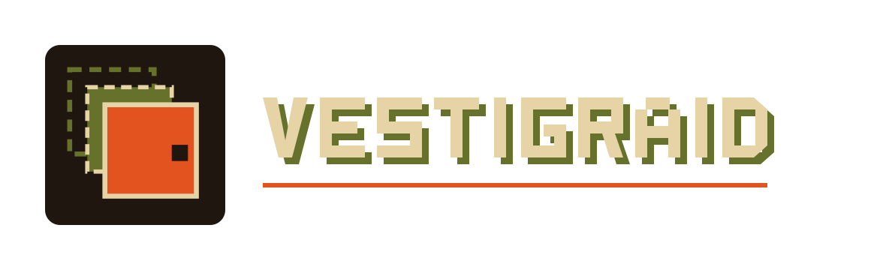
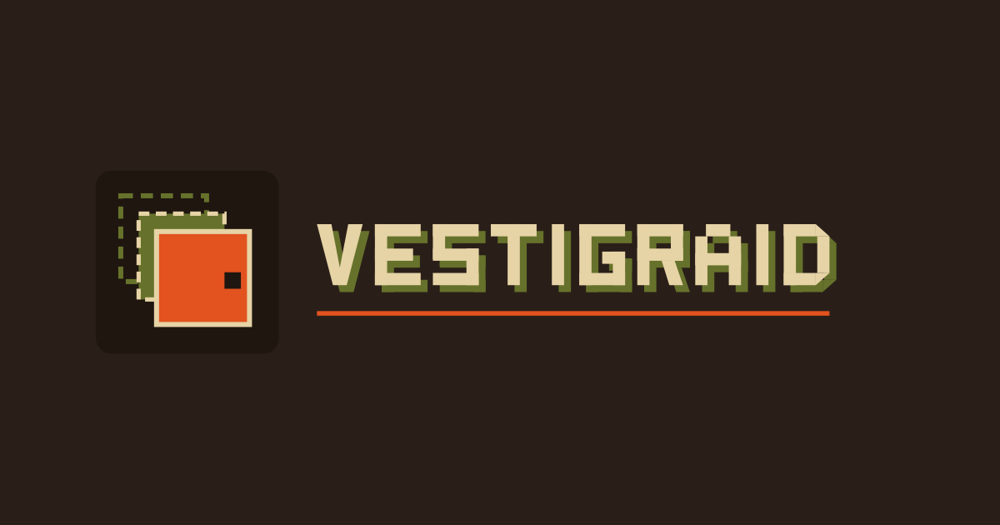
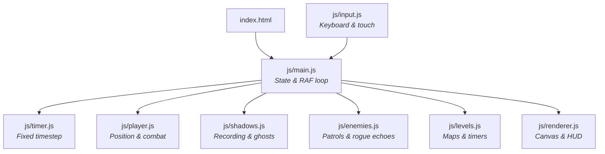

<p align="center">
  
</p>

<p align="center"><b>Every move leaves a mark. Every mark fights back.</b></p>

<p align="center">
  A tactical time-loop action puzzle game built with vanilla JavaScript, HTML5 Canvas, and modern CSS.
</p>

<p align="center">
  <a href="https://vestigraid.netlify.app/"><b>🎮 Play Online</b></a>
</p>

<p align="center">
  
  
  
  
  
</p>

---

## About

**Vestigraid** is a grid-based, time-loop puzzle game where time is both your greatest resource and your biggest obstacle.

Each level is a **Case**. Your moves and actions are recorded in real time. When you commit a loop (or time runs out), your past run becomes a **Shadow** that replays your exact steps. Shadows can hold pressure plates to keep doors open, but they also occupy grid cells and can block your future self.

Across 12 cases, puzzles escalate from simple door-holding to multi-chamber relays, sentry crossfire, laser grids, teleport portals, shifting bulkheads, and a final paradox.

## Features

- **Echo mechanics** – up to 4 shadows replay past movements and strikes in sync.
- **Pressure plates & doors** – shadows stay on their final tile, holding plates (`a`, `b`, `c`) to open linked doors (`A`, `B`, `C`).
- **Melee combat** – strike ahead (`Space`) to defeat patrolling enemies and rogue echoes, with a 3-tick cooldown.
- **Deterministic simulation** – fixed 140 ms tick with an accumulator loop and delta-time clamping, so gameplay is identical regardless of frame rate.
- **Progress saving** – unlocked cases and scores persist in `localStorage`; any unlocked case can be replayed from the Case Archive.
- **Responsive & Hi-DPI** – crisp canvas rendering on Retina/4K screens, with keyboard controls on desktop and an on-screen D-pad on mobile.
- **Zero dependencies** – no frameworks, no build step.

## How to Play

### Controls

| Action                    | Keyboard                  | Mobile / Touch    |
|---------------------------|---------------------------|-------------------|
| Move                      | `W` `A` `S` `D` / Arrows  | On-screen D-pad   |
| Strike ahead              | `Space`                   | **Strike** button |
| Commit loop               | `R`                       | **Loop** button   |
| Case select / archive     | `C`                       | **Select Case**   |
| Pause / resume            | `P` or `Esc`              | **Pause** button  |
| Reset case                | `Z` or `Backspace`        | **Reset** button  |

### Rules

1. **Start the loop** – the clock begins on your first move.
2. **Work with your echoes** – step on plates or position yourself, then press `R` to commit the loop. A shadow is created that repeats your exact timeline.
3. **Avoid enemies** – touching an enemy (or walking into its tile) means you're **Caught**, and the current loop is erased.
4. **Watch the timer** – if time expires before you reach the exit, your actions are automatically committed as a shadow and the next loop begins.
5. **Reach the exit (`E`)** to advance. In boss cases (04, 08, 12) the exit stays sealed until all enemies are defeated and required locks are held.

### Cases

| #  | Case             | Time | Concept                                                              |
|----|------------------|------|----------------------------------------------------------------------|
| 01 | Hold the Door    | 6s   | One plate, one door. Learn loops and shadow door-holding.            |
| 02 | Two Keys         | 7s   | Chain loops to trigger plates `a` and `b` in sequence.               |
| 03 | The Sentry       | 8s   | Patrolling enemy; time your crossing.                                |
| 04 | The Team         | 10s  | Boss: defeat two sentinels in the same loop to unlock the exit.      |
| 05 | The Relay        | 8s   | Triple-chamber relay with plates `a`, `b`, `c` and gates `A`, `B`, `C`. |
| 06 | Crossfire        | 9s   | Two intersecting sentry lanes plus a blast door.                     |
| 07 | The Split        | 10s  | Coordinate upper and lower wings to open gates `A`, `B`, `C`.        |
| 08 | The Last Loop    | 13s  | Boss: two fast sentinels and dual plates.                            |
| 09 | The Laser Grid   | 10s  | Pulsing and moving lasers; cross during safe windows.                |
| 10 | The Rift         | 11s  | Teleport portals (`α`, `β`) linking isolated vaults.                 |
| 11 | The Shift        | 12s  | Bulkheads that flip on an 8-tick cycle.                              |
| 12 | The Paradox      | 14s  | Four shadows, elite sentinels, and three plates held at once.        |

## Screenshot

<p align="center">
  <a href="https://vestigraid.netlify.app/">
    
  </a>
</p>

## Tech Stack

- **Engine:** vanilla JavaScript (ES2022 modules), no runtime libraries or build tools
- **Rendering:** HTML5 Canvas 2D with DPR scaling
- **Styling:** CSS3 (Flexbox, Grid, custom properties, `clamp()`), *Anton* and *Courier Prime* fonts
- **PWA:** web app manifest, maskable icons, Open Graph metadata
- **Testing:** headless Chrome via the DevTools Protocol, run with Node.js

## Project Structure

```
Vestigraid/
├── index.html            # App shell and UI layout
├── favicon.ico
├── og-image.png          # Social preview image (1200x630)
├── site.webmanifest      # PWA manifest
├── css/
│   └── style.css         # Theme, CRT effects, layout, responsive styles
├── js/
│   ├── main.js           # State coordinator, game loop, overlays
│   ├── levels.js         # ASCII maps, timers, lasers/portals/shifting walls
│   ├── player.js         # Movement, collision, combat
│   ├── enemies.js        # Patrols, hunter AI, hit detection
│   ├── shadows.js        # Loop recording, ghost playback, pressure plates
│   ├── timer.js          # Fixed-timestep accumulator and countdown
│   ├── renderer.js       # Canvas drawing, DPR scaling, HUD
│   ├── input.js          # Keyboard and touch input queue
│   ├── progress.js       # localStorage progress, scores, migrations
│   ├── scoring.js        # Three-star targets and scoring formula
│   ├── achievements.js   # Achievements and unlock conditions
│   ├── story.js          # Narrative script, 4 chapters, 21 transmission sequences
│   └── cinematics.js     # Typewriter dialog system, skip controls, overlay
├── brand/                # Logos and icons (SVG + PNG)
└── tests/
    ├── suite.js                   # Headless Chrome regression and gameplay tests (429 tests)
    ├── verify_case_transitions.js # Case completion overlay dismissal & chapter transitions
    ├── verify_full_story.js       # Story campaign narrative consistency & dialogue audit
    ├── verify_phase2.js           # Cinematic DOM bindings, typewriter effects & archive tests
    └── verify_qa_fixes.js         # Shadow loop validation & combat collision regression tests
```

### Architecture



## Getting Started

### Prerequisites

- A modern browser with ES Modules and Canvas support
- *(Optional, for tests)* [Node.js](https://nodejs.org/) v18+ and Google Chrome

### Run Locally

```bash
git clone https://github.com/cgupta21/Vestigraid.git
cd Vestigraid
```

ES modules don't load from `file://` paths, so serve the folder over HTTP:

```bash
# Python
python -m http.server 8000

# or Node.js
npx serve
```

Then open `http://localhost:8000`.

## Testing

The headless Chrome suite covers canvas scaling, collisions and walls, combat and cooldowns, state transitions, timer behavior, brand assets, responsive layout, and full solution playthroughs of all 12 cases.

```bash
node tests/suite.js
```

## Contributing

Contributions, bug reports, and suggestions are welcome.

1. Fork the repo and create a branch: `git checkout -b feature/new-case`
2. Keep the code modular, avoid heavy build dependencies, and preserve the terminal-kraft look.
3. Run `node tests/suite.js` and make sure everything passes.
4. Open a pull request describing your changes.

## Roadmap

- Procedural retro sound effects (steps, strikes, doors, alerts)
- Speedrun timer with best-time tracking
- New mechanics: multi-state switches, conveyor belts
- In-browser community level editor

## Author

**Chandan Kumar Gupta** – [@cgupta21](https://github.com/cgupta21)

## License

No license has been specified. All rights are reserved by the author. To use or adapt any part of this code, please contact the developer.
